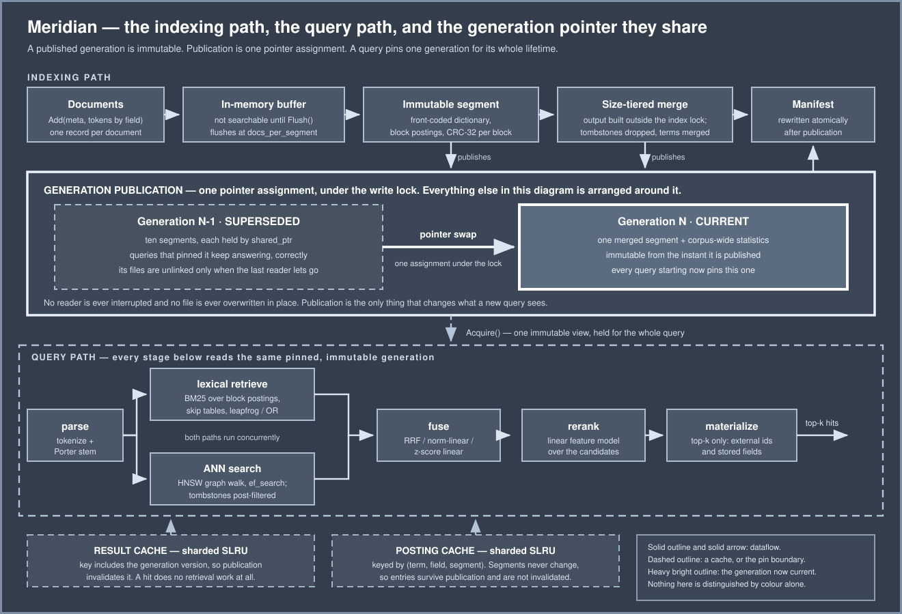

# 🔍 Meridian

*A search engine built from the posting list up — and an evaluation harness that kept contradicting the folklore I built it on.*



Meridian is a hybrid search engine in **22,920 lines of C++20 and 2,974 lines of Python**, with **311 tests** — 219 C++ across 16 suites and 92 Python — all clean under AddressSanitizer, UndefinedBehaviorSanitizer and ThreadSanitizer. It has no dependencies outside each language's standard library: the JSON, the varint codec, the CRC-32, the HNSW graph, the Porter stemmer and the PRNG are all written here, because the point was to understand them.

It does block-structured posting lists with skip tables, a front-coded term dictionary, immutable segments with size-tiered merging, BM25 with field weighting, an HNSW vector index, three fusion strategies, a sharded SLRU cache, a deadline-aware serving pipeline, and an IR evaluation harness with NDCG/MRR/P@K/R@K.

The part I would actually put in front of someone is what the measurements did to my assumptions. **Every one of these was something I believed, wrote into a comment, and then had to correct:**

- **"Rarest-first ordering is worth orders of magnitude."** In my conjunctive merge it is worth **1.02×**. The textbook claim is true of a formulation I did not write — the version that scans a leader list without re-advancing it, where I measure 4.72× — but my leapfrog implementation is nearly order-insensitive by construction, because all cursor movement is target-driven. I kept the better algorithm and reported the smaller number.
- **"More candidates means better results."** On the small collection the opposite, measured: NDCG@10 falls from **0.9566 to 0.8827** as `candidate_k` goes 10 → 2000, while p99 rises **~15×**. Part of that is real and part is the judged pool's edge — `unjudged` climbs 0 → 38. On a 50,000-document collection the direction **reverses** (0.6748 → 0.7306, peaking at 800) because the pool no longer runs out. The transferable finding is not "more is worse"; it is that this curve is a property of the collection and quoting it without one is meaningless.
- **"Approximate search is a quality/latency tradeoff."** In a *hybrid* pipeline it is barely a tradeoff at all. Dropping index-level recall from 1.00 to 0.66 costs **0.78% of NDCG@10**, because the lexical path independently finds many of the same documents; removing that path multiplies the movement by 1.9×. I first wrote that quality is "insensitive until recall falls below 0.98" — that is not supported. The curve is **non-monotone**, and the non-monotonicity (0.0070) is *larger than the entire range* (0.0053), so there is no knee to find. The honest statement is stronger than the one I reached for: across the whole recall range from 0.66 to 1.00, final NDCG@10 is flat within noise.
- **"HNSW beats brute force."** Not on a small corpus. Brute force **wins** at 1,200 vectors (5.38µs vs 5.83µs). Holding dimension constant at 52, the crossover is **~1,500 vectors** — 0.80× at 1,200, 1.02× at 1,500, 1.50× at 2,000 — and the advantage reaches 14.5–17.0× at 50,000 across runs.
- **"Merging reduces write amplification."** It raises it, correctly, and I had the measure backwards. One full merge takes amplification from 1.00 to **2.57** — above the naive 2.0 — because one merged segment is *more compact* than the segments it replaced, so the live denominator shrinks below what the flushes wrote. Merging ten segments of 4,999 documents takes the dictionary from 103,939 entries to 30,768 and the data from 17.39 MiB to 12.83 MiB. Amplification above 2.0 is evidence the merge is working.

**Three defects were found by benchmarks that 219 passing tests did not catch**, and two were near-misses I caught in the act of fixing something else. The worst: a corrupt posting block was indistinguishable from the end of a list, so a query silently returned a truncated result set and reported success. The detection mechanism existed; nothing consulted it.

## ✨ Why I Built It

I wanted to know what is actually in a search engine, and the only way I trust to find out is to write the parts that are usually a library call. A posting list is easy to describe and full of decisions once you have to seek inside one. An inverted index is a dictionary of term → documents until you need it to be immutable, mergeable, and queryable while a merge is running.

The second reason was evaluation. It is easy to make a retrieval system *feel* better and very easy to make it measurably worse while feeling better, because relevance is multi-objective and latency is the objective nobody notices until it regresses. So the harness came first-class rather than bolted on, and it has a verdict that neither a win nor a loss: `kTradeoff`, for a change that improves quality and costs latency. Most of my changes were that.

## 🔭 What It Does

**Indexing.** Documents go into an in-memory buffer, flush to an immutable segment, and become visible through an atomically published generation. Segments merge on a size-tiered policy. Deletes are tombstones; space returns at the next merge, and the CLI says so rather than implying the delete reclaimed anything.

**Lexical retrieval.** Block-structured posting lists with a fixed-width skip table, delta+varint document gaps, per-block CRC-32, BM25 with per-field weights, phrase queries over positions, conjunctive (leapfrog) and disjunctive evaluation, and structured filters applied before scoring.

**Vector retrieval.** A hand-written HNSW graph — multi-layer, `1/ln(M)` level draw, neighbour-selection heuristic, symmetric edges — with cosine, inner product and squared L2 kernels, persistence with a checksummed format, and `SearchExact` kept as the ground truth its recall is defined against.

**Fusion and ranking.** Reciprocal rank fusion, min-max normalized linear combination, and z-score linear combination, then a feature-based linear reranker.

**Serving.** A staged pipeline with per-stage tracing, a sharded segmented-LRU result cache and posting cache, bounded work queues that refuse rather than grow, and deadline enforcement at stage boundaries.

**Evaluation.** NDCG, MRR, P@K, R@K with graded judgements, parameter sweeps, a baseline/candidate comparison with an explicit tradeoff verdict, and a Python corpus generator whose statistical properties are verified numerically rather than asserted.

## 🧱 How I Built It

C++20 for the engine, Python for corpus generation and reporting. `Status`/`Result<T>` instead of exceptions, because a search engine's failure modes are mostly *data* being wrong and the worst outcome is a plausible wrong answer rather than a crash.

The design constraint that shaped the most code: **a published generation is immutable, and a query holds one for its whole lifetime.** Segments are `shared_ptr`-held, a merge builds its output outside the index lock, and publication is a single pointer swap. That is what lets 1,438 queries run against a superseded generation while all ten of its segments are merged away, with the files unlinked only once the last reader lets go.

Four things I deliberately did not do, each with a reason in the code: no mmap (a page fault is invisible to a `bytes_read` counter and an I/O error on a mapped page is SIGBUS, not a `Status`); no multi-level skip list (making the table fixed-width turns the search into a binary search over a sorted array — 17 comparisons where a varint-scanned level needs 78,000 decodes — which removes the problem the second level exists to paper over); no mutex inside `HnswIndex::Search` (it would be a false promise of scalability; a real deployment wants one index per shard); and no hash-based term dictionary (it discards the order that prefix queries and the merge's linear two-stream walk both need).

## 📊 What the Measurements Say

Full detail in [`bench/results.md`](bench/results.md) and reproducible with [`scripts/demo.sh`](scripts/demo.sh).

### Skip lists do what they claim

A 200,000-posting list, 200 widely separated seek targets:

| | postings decoded | blocks read |
|---|---|---|
| sequential | 200,000 | 1,563 |
| skipping | 24,000 | 188 |

**8.3× fewer postings decoded**, landing on an identical document for every seek. 188 distinct blocks out of 1,563 is close to the floor for this access pattern, so most of the available win is taken. A differential test drives 12,800 seeks across 80 lists comparing the skipping iterator, the sequential iterator and `std::lower_bound`, requiring all three to agree on document, term frequency, positions and size hint.

Delta+varint against fixed-width on a dense 100k list: 217,166 vs 800,000 bytes, **3.68×**.

### Hybrid retrieval beats either half, by a lot

Same corpus and queries, weights on the lexical/semantic paths:

| configuration | NDCG@10 | P@10 | MRR |
|---|---|---|---|
| lexical only | 0.8161 | 0.2521 | 0.8611 |
| **both (RRF)** | **0.9509** | **0.3875** | **1.0000** |
| semantic only | 0.2203 | 0.2500 | 0.2500 |

Fusion is worth **+0.1348 NDCG** over lexical alone *and* is faster at p99, because the reranker gets a better candidate set and stops early. Semantic-only is poor here because the generated embeddings carry topic structure rather than lexical precision — which is exactly why hybrid exists, and the number is reported rather than hidden.

Fusion strategies differ measurably but not dramatically, **and their ordering is not stable across collections**: on the small one norm-linear leads (0.9614 vs RRF 0.9509 vs z-score 0.9505), while on 50,000 documents RRF wins and norm-linear is scored `worse` (0.6986 vs 0.6735 vs 0.6642). Rank-based fusion stops caring about score scale, which matters more as the two paths' score distributions drift further apart. Any claim that one strategy is better than another needs the collection attached.

### Approximate search, and the honest version of the tradeoff

Index-level recall against brute force over the same 50,000 vectors, dimension 52:

| ef_search | recall@10 | p50 | distances/query |
|---|---|---|---|
| exact | 1.0000 | 330.2µs | 50,000 |
| 10 | 0.6625 | 5.0µs | 320 |
| 64 | 0.9615 | 20.6µs | 787 |
| 256 | 0.9990 | 49.5µs | 1,180 |
| 512 | 1.0000 | 78.5µs | 1,268 |

Then the same dial through the whole hybrid pipeline: NDCG@10 moves only **0.6726 → 0.6779** across the entire range — 0.78%, against an index recall that ranges from 0.66 to 1.00. There is no knee in that curve: it is non-monotone, and its non-monotonicity (0.0070) exceeds the whole range (0.0053), so a reading that locates a threshold is reading noise. Flat within noise across the entire range is the finding. At `ef_search=640` the approximate path is identical to exact search on every metric at 12.7× less stage time.

The neighbour-selection heuristic is the single clearest result in the suite. Against naive top-M selection on the same data and seed:

| ef_search | heuristic | top-M |
|---|---|---|
| 10 | 0.6900 | 0.3163 |
| 128 | 1.0000 | 0.3925 |
| 512 | 1.0000 | 0.3925 |

Top-M **plateaus at 0.3925 and stops improving entirely**, while getting cheaper — the graph is tight clumps with no long-range edges, so widening the beam cannot escape the clump it started in.

### Where brute force wins

All at dimension 52, so the only thing varying is n:

| vectors | exact | HNSW ef=64 | speedup |
|---|---|---|---|
| 1,200 | — | — | **0.80× — slower** |
| 1,500 | — | — | 1.02× — the crossover |
| 2,000 | 15.9µs | 11.5µs | 1.50× |
| 10,000 | 70.2µs | 12.3µs | 5.7× |
| 50,000 | 330.2µs | 20.6µs | 14.5–17.0× |

Exact is linear; the graph is roughly flat. The crossover is **~1,500 vectors**, and the 50,000-vector ratio is a band across runs rather than a single figure — quoting 16.0× bare would imply a precision the measurement does not have.

On the 1,200-vector demo collection the ANN path is a straight loss (5.38µs exact vs 5.83µs) *and* pointless: recall is already 1.0 at every beam width, so no wider beam could buy anything. That collection is kept in the suite as a labelled negative control, because a benchmark whose rows are all identical is exactly the shape that looks like a result and is not one.

### Distance kernels: the vectorizer is being correct, not timid

Dimension 128, 200 reps: explicit 8-wide unrolling with 4 accumulators beats the scalar loop by **~2.1× (dot), ~3.5× (L2²), ~2.5× (cosine)**, each a mid-band figure over six runs (2.00–2.24, 3.31–3.69, 2.41–2.63). Reading the generated assembly during development explained why clang only gets half of it: it vectorizes the multiplies (`fmul.4s`) and then extracts every lane to sum them serially through one accumulator. The reduction cannot be vectorized at `-O2` because float addition is not associative — the vectorizer is being correct, not timid. Writing four accumulators in the source *is* the author authorizing that reassociation, and the honest cost is a test showing the two implementations diverge without bound where the sum cancels.

### Merge economics

| | write amplification | bytes/doc |
|---|---|---|
| after flushes only | 1.00 | 156.4 |
| after one full merge | 2.57 | 256.2 |

1.00 before any merge is the check that the denominator measures what it claims. 2.57 rather than 2.0 is the interesting part, explained above: merging ten segments of 4,999 documents takes the dictionary from 103,939 entries to 30,768 and the data from 17.39 MiB to 12.83 MiB, so the live denominator ends up smaller than what the flushes originally wrote. A tombstone, by contrast, changes neither size nor term count — the space returns at the merge and not before, which the CLI states rather than implying the delete reclaimed anything.

### Serving

A sharded SLRU cache where 8 hot keys accessed twice survive 500 unique inserts intact, with `evictions == 500 - scan_survivors` exactly — survivors *of the scan*, which is a different count from the hot set's and is the one the eviction arithmetic has to balance against. That is the property distinguishing SLRU from LRU under a scan: entries enter probation and are promoted only on a second access, so a run of never-repeated queries churns within probation and cannot evict the hot set.

Admission control: 60 offered, 3 accepted, 57 refused in 93ms, worst accepted wait 33ms against a 300ms bound. Roughly 1,400 queries served from a superseded generation while its segments were merged away (1,384–1,583 across runs, against 159–189 flushes and 53–63 merges) with 0 inconsistencies. 800 concurrent queries at p99 0.20–0.26ms.

## 📚 What I Learned

**A benchmark with no shape cannot distinguish a good implementation from a bad one.** My first HNSW dataset reported recall@10 = 1.0000 at every `ef_search` from 16 up. That curve would have looked like a vindication and would have reported 1.0 for a graph with serious connectivity problems. Raising n and dimension and lowering M gave the dial real range — and the test now asserts recall at ef=k is *below* 0.9, so if a future change makes the benchmark trivial again, it says so instead of passing.

**The folklore is usually about a formulation, not a result.** Rarest-first ordering being worth orders of magnitude is true, of an algorithm I did not write. Writing the better algorithm made the famous optimization nearly irrelevant, which is a more interesting finding than reproducing the number would have been.

**Absence is the most dangerous signal in a storage format.** A corrupt block stops a walk and reports "no more documents" — byte-for-byte what the end of a list looks like. Every other failure in this system is loud. This one returns four of nine matches and says `ok`, and nothing downstream can detect it. The fix was not the detection, which already existed; it was making the interface able to express it and the query layer obliged to ask.

**A fixed-width table beats a cleverer variable-width one when the access pattern is search.** The multi-level skip list exists because its skip data must be *scanned* to be read. Making entries fixed-width makes the table a sorted array and the search a binary search with no decode at all, which deletes the reason for the second level instead of optimizing around it. The price is 12 bytes per entry instead of ~6 — 0.05 bytes per posting.

**Composing two components that pass their own tests proves nothing about the pair.** The `ef_search` axis was inert for the entire time the HNSW index and the serving pipeline both had green suites, because the pipeline used brute-force exact search and never touched the graph. The ANN code was effectively dead outside its own unit tests, and no test in either component could have noticed.

**Multi-objective means a third verdict.** A comparison that can only say better or worse will call a quality gain with a latency cost one of the two, and which one depends on whoever wrote the threshold. Making `kTradeoff` a first-class outcome forced every sweep to state both numbers, which is how the `candidate_k` result became legible instead of looking like a regression.

## ⚖️ What I Do Not Claim

**This is not competitive with Lucene or a production vector database**, and the gaps are structural rather than a matter of tuning. There is no query planner, no distributed sharding, no incremental graph publication, no WAND/MaxScore top-k pruning, and no learned ranking.

**The corpus is generated, so absolute quality numbers describe the generator as much as the engine.** The generator's properties are verified numerically — measured log-log rank-frequency slope −1.090 at a Zipf exponent of 1.05, intra-topic cosine 0.9645 against inter-topic 0.1811 — which makes the comparisons between configurations meaningful. It does not make NDCG 0.95 a statement about real documents. A TREC-style collection would be the honest next step.

**The semantic path is serialised across concurrent queries.** `HnswIndex::Search` is documented as not thread-safe and deliberately refuses an internal mutex rather than promise scalability it does not have; the serving decorator holds a lock. That is correct and it is the wrong design for a real deployment, which wants one index per shard with per-thread scratch. The lock is load-bearing rather than defensive: removing it during development produced 7 ThreadSanitizer reports, which is why it is there. That check is not reproducible from a clean checkout — it needs the lock taken back out — so what the committed suite demonstrates is the other half: the TSAN build passes 16/16 with the lock in place.

**The HNSW graph is not generation-versioned.** It is built from one snapshot, so a generation published afterwards is invisible to the semantic path until a rebuild. Deletes are still honoured, by post-filtering against the pinned generation's tombstones. For a continuously-indexing system this needs an incremental publication scheme for the graph, which is a real piece of work and is not here.

**Filters are post-applied on the vector path.** A filter selecting 1% of the corpus removes almost everything the graph returned, so the semantic path contributes a handful of candidates instead of `candidate_k`. The stage over-fetches 4× to mitigate it. The actual fix is a filter-aware beam search inside the graph.

**`bytes_read` is honest only because I chose pread over mmap**, and that choice costs a syscall per block. A production engine would likely take the mmap and lose the instrumentation.

**Per-field BM25 normalization is not expressible** against a document record that carries only a whole-document length, so field-weighted scoring normalizes every field by the same length. That is not BM25F.

**Corpus document frequency across per-field dictionaries is a lower bound.** Summing df over fields double-counts any document holding a term in both its title and body, which is the normal case; I take the max over fields within a segment, summed across segments. Exact when one field dominates, an underestimate otherwise.

## 🛠️ Tech Stack

- **C++20** — engine, CLIs, tests. No external dependencies.
- **Python 3** — corpus generation, embeddings, workload synthesis, reporting. Standard library only.
- **CMake** ≥ 3.20, with ASAN/UBSAN and TSAN as separate build types.
- Hand-written: JSON, varint/delta codec, CRC-32, front-coded dictionary, HNSW, Porter stemmer, SplitMix64, binary heap, sharded SLRU.

## 🚀 Setup

```bash
cmake -S . -B build && cmake --build build -j8
ctest --test-dir build                       # 219 tests across 16 suites
python3 -m unittest discover -s python/tests # 92 tests
```

The whole thing end to end, 11 narrated steps with the claim each one supports:

```bash
./scripts/demo.sh
```

Index a corpus, watch a tombstone not reclaim space, then watch a merge reclaim it:

```bash
./build/meridian_index --corpus corpus.tsv --docs-per-segment 2 --merge --delete d3
```

Search, with a per-stage trace:

```bash
./build/meridian_search --corpus corpus.tsv --hybrid --top-k 3 "generation cache stale answer"
```

Sweep a parameter and get a verdict per row:

```bash
./build/meridian_eval --corpus corpus.tsv --sweep ef_search=10,64,256,640
```

Generate a corpus with verified statistical properties:

```bash
PYTHONPATH=python python3 -m meridian_eval generate \
    --out /tmp/collection --documents 50000 --topics 48
```

Sanitizer builds:

```bash
cmake -S . -B build-asan -DMERIDIAN_ASAN=ON && ctest --test-dir build-asan
cmake -S . -B build-tsan -DMERIDIAN_TSAN=ON && ctest --test-dir build-tsan
```

## 🗺️ Repository Map

```
include/meridian/     The frozen contracts: status, postings, index, retrieval, eval
src/storage/          pread I/O, atomic file writes, CRC-32, fixed/varint coding
src/postings/         Block encoder, fixed-width skip table, sequential & skipping iterators
src/index/            Front-coded dictionary, segment builder/reader, generations, merging
src/query/            Tokenizer + Porter stemmer, query parser, BM25, leapfrog conjunction
src/rank/             RRF, min-max linear, z-score linear fusion; feature reranker
src/ann/              HNSW graph, distance kernels, checksummed persistence
src/serve/            Staged pipeline, sharded SLRU caches, task pool, deadlines
src/eval/             NDCG/MRR/P@K/R@K, sweeps, baseline-vs-candidate verdicts
python/meridian_eval/ Corpus + embedding generation, workloads, reporting
tools/                meridian_index, meridian_search, meridian_eval
bench/results.md      Every measurement quoted above, with how it was taken
docs/img/             Architecture and query-path diagrams, hand-written SVG
scripts/demo.sh       11 steps, each stating what it proves
```

## 📄 License

MIT
